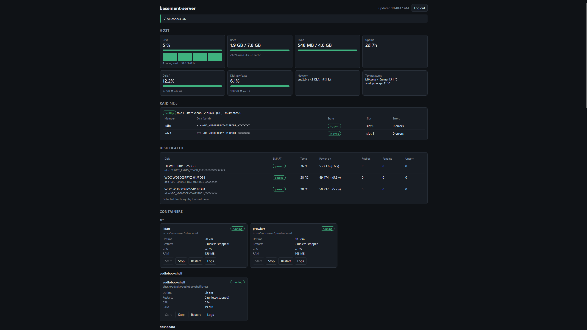

# homelab-dashboard

A small, self-hosted status page for a Linux home server. One page shows host load, disk and RAID health, SMART data and your Docker containers, and lets you **start, stop, restart and read the logs** of containers. It is built to run with as few privileges as possible.

> ⚠️ **Never expose this dashboard to the internet.** No port forwarding, no public reverse proxy, no Cloudflare Tunnel. It can stop your containers (including DNS and VPN ones). Run it on your LAN and/or over a private VPN like Tailscale only. See [Security model](#security-model).





## Features

- **Host:** CPU (per core), RAM, swap, uptime, load, temperatures, network throughput, disk usage for `/` and any paths you choose.
- **Containers:** state, health, CPU/RAM, restart count and exit reason for every container, grouped by compose project; start / stop / restart / logs buttons; an audit log of every action.
- **Alerts banner:** degraded RAID, failing or hot disks, stale SMART data, full disks, high RAM, crashed or unhealthy containers.
- **SMART disk health** (via a small root job on the host; the container never gets disk access), see [docs/smart-setup.md](docs/smart-setup.md).
- **md RAID panel** (optional; hides itself when there is no md RAID).
- Safety rails: the dashboard cannot stop itself, and stopping access-critical containers (DNS, tunnels, VPN) asks for confirmation.
- Light and dark theme, no external requests, no JavaScript dependencies.

## Requirements

- Linux host with Docker Engine and the Docker Compose plugin (v2)
- `openssl`, `python3` on the host (for the helper scripts)
- For SMART: `smartmontools` and `python3-yaml` on the host, and `sudo`
- A LAN address, and optionally a Tailscale address, for the host

## Install

```bash
git clone https://github.com/DylanPrzepiora/homelab-dashboard.git
cd homelab-dashboard

# 1. configuration
cp .env.example .env              # addresses, host paths
cp config.example.yaml config.yaml    # title, disks, mounts
$EDITOR .env config.yaml          # replace every placeholder

# 2. password (there is no default; the app will not start without one)
./set-password.sh

# 3. TLS certificate (self-signed, for the LAN/Tailscale addresses in .env)
./make-cert.sh

# 4. data directory, writable by the user set as PUID/PGID in .env
mkdir -p data && sudo chown "$(grep ^PUID .env | cut -d= -f2):$(grep ^PGID .env | cut -d= -f2)" data

# 5. start
docker compose up -d --build
```

Open `https://<LAN_IP>:<DASH_PORT>` (default port 8088). Your browser warns about the self-signed certificate once; that is expected.

For SMART and RAID, continue with [docs/smart-setup.md](docs/smart-setup.md). To update later, run `./update.sh` (the image is built locally, so Watchtower cannot update it).

## Configuration

Two files, both git-ignored. Start from the examples.

### `.env` (see [.env.example](.env.example))

| Variable | Default | Meaning |
|---|---|---|
| `LAN_IP` | *required* | Host LAN address the port is bound to. |
| `TAILSCALE_IP` | *required* | Host Tailscale address the port is bound to (delete that `ports:` line if unused). |
| `DASH_PORT` | `8088` | Published port. |
| `NET_IFACE` | *required* | NIC whose traffic counters are shown. |
| `DATA_PATH` | *required* | Host path shown as an extra disk-usage card (mounted read-only at `/host/data`). |
| `SMART_DIR` | `/var/lib/dashboard` | Directory the host collector writes `smart.json` into (mounted read-only). |
| `PUID` / `PGID` | `1000` / `1000` | User the container runs as. |
| `TZ` | `UTC` | Time zone. |
| `COMPOSE_FILE`, `RAID_DEVICE` | unset | Uncomment both to enable the md RAID panel. |
| `DASH_PASSWORD_HASH` | empty | Written by `./set-password.sh`. The app refuses to start if empty or malformed. |
| `DASH_TITLE` | from config | Optional override of the page title. |

### `config.yaml` (see [config.example.yaml](config.example.yaml))

| Key | Default | Meaning |
|---|---|---|
| `title` | `Homelab Dashboard` | Page title. |
| `confirm_before_stop` | `pi-?hole\|adguard\|cloudflared\|tailscale\|wireguard` | Regex; matching containers ask for confirmation before stop/restart. |
| `self.project`, `self.container_names` | `dashboard`, `[dashboard, dashboard-socket-proxy]` | Containers that can never be stopped from the UI. |
| `mounts` | `[]` | Extra filesystems: `label` and in-container `path`. |
| `raid.device` | `md0` | md device (fallback for `RAID_DEVICE`); empty hides the panel. |
| `smart.stale_after_minutes` | `30` | Older SMART data is flagged STALE. |
| `smart.temp_warn_c` | `55` | Disk temperature warning. |
| `smart.disks` | none | Disks to read, by `/dev/disk/by-id` name, with `label`, optional `type`, `skip_standby`. |

## Security model

The goal is that a bug or a stolen session in this app cannot easily become control of your server.

- **Docker access goes through a socket proxy.** The dashboard never touches `/var/run/docker.sock`. A [docker-socket-proxy](https://github.com/Tecnativa/docker-socket-proxy) container with a strict allow-list ([docker-proxy/haproxy.cfg.template](docker-proxy/haproxy.cfg.template)) is the only thing that does, and it permits only: **list/inspect/stats/logs (GET)** and **start/stop/restart (POST)** on containers. Create, exec, delete, images, volumes, networks and everything else are denied. The proxy sits on an internal Docker network with no published ports and no route out.
- **Unprivileged container.** Non-root user, read-only root filesystem, all capabilities dropped, `no-new-privileges`, memory and CPU limits. Host files (RAID, NIC counters, SMART, data path) are mounted **read-only**. No disk devices, no privileged mode.
- **Login required, no default password.** The password is stored only as a salted scrypt hash. The app refuses to start until one is set. Failed logins are rate-limited per client and globally, and logged without the attempted password.
- **CSRF protection.** Every state-changing request needs a per-session CSRF token and a matching `Origin`. Session cookies are `__Host-`prefixed, `HttpOnly`, `Secure`, `SameSite=Strict`. Responses carry a strict CSP and security headers.
- **Audit log.** Logins and every start/stop/restart are written to `data/actions.log`.
- **LAN/Tailscale only.** `docker-compose.yml` binds the port to the specific LAN and Tailscale addresses you set, never to all interfaces. HTTPS with a self-signed certificate.
- **Never expose it to the internet.** Do not port-forward it, do not put it behind a public reverse proxy or tunnel, and do not bind it to `0.0.0.0`. Even with the protections above, an internet-facing container controller is a bad idea. Also check that your host firewall does not publish it, since Docker-published ports bypass some firewall setups.

To report a vulnerability see [SECURITY.md](SECURITY.md).

## SMART and RAID in short

- **SMART:** reading SMART needs root, which the container never gets. A systemd timer on the host runs a small script every 10 minutes as root, which writes `/var/lib/dashboard/smart.json`; the container reads that file read-only. If the file is missing or older than `smart.stale_after_minutes`, the dashboard says so plainly instead of showing old values as current. Full step-by-step guide, including NVMe, USB bridges, hardware RAID and troubleshooting: **[docs/smart-setup.md](docs/smart-setup.md)**.
- **RAID:** for mdadm arrays, the dashboard reads `/proc/mdstat` and `/sys/block/<mdN>/md/` read-only (state, degraded, rebuild progress, member disks, error counts). Without md RAID the section is simply hidden. Details in [docs/smart-setup.md](docs/smart-setup.md#8-raid-md-panel).

## License

[MIT](LICENSE)
